# 知账 Smart Ledger · UI/UX 审查报告

| 项目 | 内容 |
|---|---|
| 应用版本 | 0.29.11+77 |
| 审查日期 | 2026-10-20 |
| 审查对象 | `D:\Software\Android\smart_ledger` |
| 设备环境 | Android 17 模拟器，1080×2400 @420dpi（411×914dp），系统字号 100% |
| 审查方式 | 源码静态审查 + 模拟器实机截图（浅色/深色、大字号、窄屏、空态、删除撤销、回收站、弹窗、编辑器、FAB 菜单） |
| 代码规模 | 95 个 Dart 文件，约 39,487 行 |
| 源码改动 | 无。仅在模拟器内产生测试账目并临时切换主题，审查结束后已恢复浅色 |

---

## 1. 摘要

这是一款完成度较高的个人记账应用：Material 3 主题集中管理、品牌绿统一、错误处理中心化（`showError` 93 处）、删除可撤销、回收站、加载态覆盖 48 处、`SafeArea` 使用 18 处，深色模式实测可用。

主要问题不在"审美"，而在**体系化与边界适配**：

1. **设计 token 未落地**：159 处 `Colors.*`、22 处 `Color(0x`、108 处硬编码 `fontSize`、300 处 `SizedBox(height:)`，跨页一致性靠人工维护。
2. **触控与适配不足**：筛选 Chip 实测约 30dp；大字号下标题、账本名、月份出现截断。
3. **信息架构偏重**：「管理」26 项 / 7 组，高频设置埋在中段。
4. **颜色语义不统一**：支出与负数在橙、红、绿之间摇摆。
5. **反馈层次单一**：成功与失败使用同一种 SnackBar；全局 0 处触觉反馈。

**综合评分：6.2 / 10**

---

## 2. 审查方法与证据

### 2.1 静态审查

- 页面与导航：`home_shell.dart`、`manage_page.dart`、`analysis_page.dart`、`transaction_editor.dart`
- 主题与组件：`main.dart`、`widgets.dart`、`appearance_page.dart`、`domain/appearance.dart`
- 次级流程：`home_shell.dart`、`transaction_editor.dart`、`tools/markdown` 与离线同步等 12 个页面
- 状态与错误：`app_state.dart`、`action_form.dart`

### 2.2 运行实测

- 浅色 / 深色双主题
- 大字号（约 1.5×）
- 窄屏（720px 物理宽度）
- 空状态、左滑删除、撤销 SnackBar、回收站、清空确认弹窗
- 记一笔编辑器的折叠/展开、金额输入、保存
- FAB 五种记账入口

### 2.3 证据截图

截图已归档到 `docs/previews/ui-review/`：

| 文件 | 内容 |
|---|---|
| `01-home-light.png` | 总览（浅色） |
| `02-flow-light.png` | 全部流水（浅色） |
| `03-accounts-light.png` | 我的账户（浅色） |
| `04-analysis-light.png` | 收支分析（浅色） |
| `05-manage-light.png` | 账本管理（浅色） |
| `06-home-dark.png` | 总览（深色） |
| `07-analysis-dark.png` | 收支分析（深色） |
| `08-manage-dark.png` | 账本管理（深色） |
| `09-appearance-light.png` | 外观与主题 |
| `10-editor.png` | 记一笔（折叠态） |
| `11-editor-inputs.png` | 金额/商户输入区细节 |
| `12-fab-menu.png` | FAB 五种入口 |
| `13-empty-state.png` | 流水空状态 |
| `14-swipe-delete-undo.png` | 左滑删除 + 撤销 |
| `15-destructive-dialog.png` | 清空回收站确认弹窗 |
| `16-trash.png` | 回收站 |
| `17-large-font-truncation.png` | 大字号截断 |
| `18-narrow-width.png` | 窄屏表现 |

---

## 3. 界面现状速写

> 这一节只描述"现在长什么样"，不评价。

### 3.1 全局视觉语言

- **底色**：暖白 `#F7F8F2`，卡片纯白 `#FFFFFF`，1px 浅灰绿描边，圆角约 18dp，无阴影。
- **主色**：深绿 `#106B57`；选中态使用薄荷绿 `#A2F2D9`。
- **文字**：系统字体；标题 24sp 粗体，列表标题 16sp 半粗，正文 14sp，辅助 12sp 灰绿。
- **顶部**：左侧品牌书本图标 + 页面标题；右侧当前账本名 + 下拉箭头。
- **底部**：72dp 导航栏，五个 Tab（总览 / 流水 / 账户 / 分析 / 管理），选中项为薄荷绿胶囊 + 深色加粗标签。
- **悬浮按钮**：右下 48dp 深绿圆角方形 FAB，白色「+」。
- **整体观感**：单列卡片流、留白充足、信息密度中等偏低，偏"温和的财务工具"而非"数据仪表盘"。

### 3.2 总览

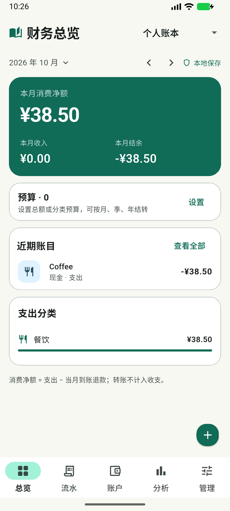

- 标题「财务总览」，右侧「个人账本 ▾」。
- 第二行「2026 年 10 月 ▾」，右侧 `‹` `›` 与盾牌图标「本地保存」。
- 深绿大卡：左上「本月消费净额」，`¥38.50` 白色大字；底部两列「本月收入 ¥0.00」「本月结余 -¥38.50」。
- 「预算 · 0」白卡：标题 + 副标题「设置总额或分类预算，可按月、季、年结转」+ 右侧绿色「设置」。
- 「近期账目」白卡：标题 + 右侧「查看全部」；一行浅蓝图标底的「Coffee / 现金 · 支出 / -¥38.50」。
- 「支出分类」白卡：标题 + 「餐饮 / ¥38.50」+ 一条满宽绿色进度条。
- 页脚浅灰说明：「消费净额 = 支出 - 当月到账退款；转账不计入收支。」
- 卡片之间约 14dp 间距，内容不足时下方留白很大。

### 3.3 全部流水

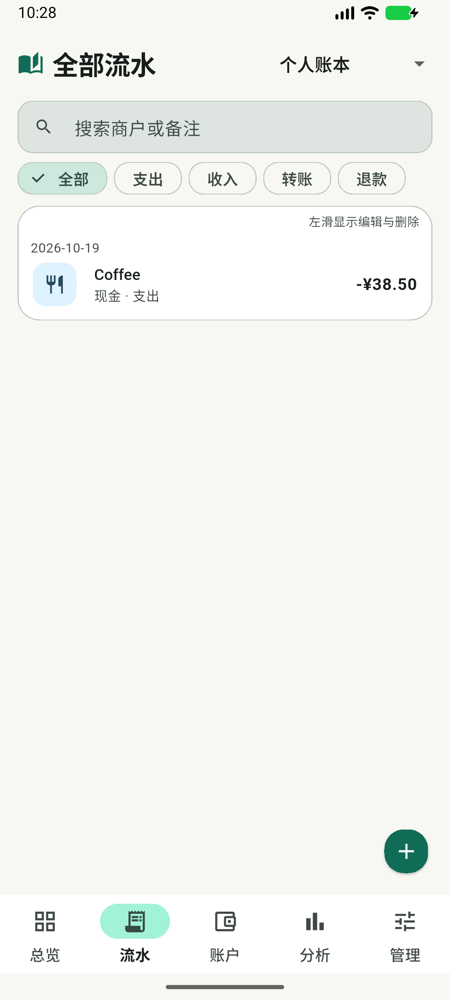

- 顶部搜索框：灰绿填充 `#DEE4E0`、圆角、放大镜 + 「搜索商户或备注」。
- 一排五个筛选 Chip：全部（浅绿选中 + ✓）、支出、收入、转账、退款。
- 一张大白卡包住所有流水，右上角 11sp 提示「左滑显示编辑与删除」。
- 行内容：日期「2026-10-19」；下一行图标 + 「Coffee」+「现金 · 支出」+ 右侧「-¥38.50」。
- 空状态：卡片内居中绿色书本图标 + 「没有找到记录」+「记一笔账，或换个搜索条件。」
- FAB 展开时，右侧浮出浅灰绿面板，列出手动记账 / 语音记账 / 一句话记账 / OCR 截图记账 / 模板记账，FAB 变为白底绿「+」。

### 3.4 我的账户

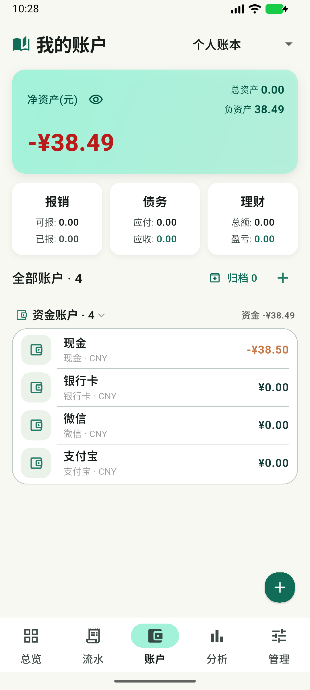

- 薄荷绿净资产卡：「净资产(元)」+ 眼睛图标；右上「总资产 0.00 / 负资产 38.49」；左下 `-¥38.49` 红色大字。
- 三张白卡并排：报销（可报/已报）、债务（应付/应收）、理财（总额/盈亏），每张两行 12sp 小字。
- 「全部账户 · 4」，右侧「归档 0」+ 绿色「+」。
- 分组「资金账户 · 4」+ 右侧「资金 -¥38.49」。
- 一张大卡内四行：现金 / 银行卡 / 微信 / 支付宝。每行左侧浅绿圆角方块 + 同一个钱包图标，主标题、副标题「类型 · CNY」，右侧余额；行间有分割线；现金余额为橙红色。

### 3.5 收支分析

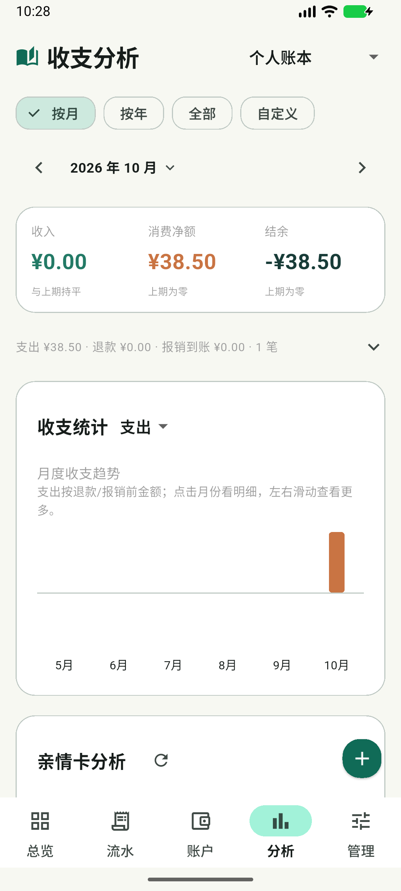

- 顶部四个 Chip：按月（选中）、按年、全部、自定义。
- `‹ 2026 年 10 月 ▾ ›`。
- 汇总白卡：收入 `¥0.00`（绿）、消费净额 `¥38.50`（橙）、结余 `-¥38.50`（深色）；下方三行小字「与上期持平 / 上期为零 / 上期为零」。
- 一行可折叠摘要：「支出 ¥38.50 · 退款 ¥0.00 · 报销到账 ¥0.00 · 1 笔」+ ▾。
- 大图表卡：「收支统计 支出 ▾」；「月度收支趋势」+ 两行说明；图中只有一根橙色柱；横轴 5 月–10 月；柱区上下空白较多。
- 下方「亲情卡分析」卡 + 刷新图标。
- FAB 悬浮并压住第二张卡右上角。

### 3.6 账本管理

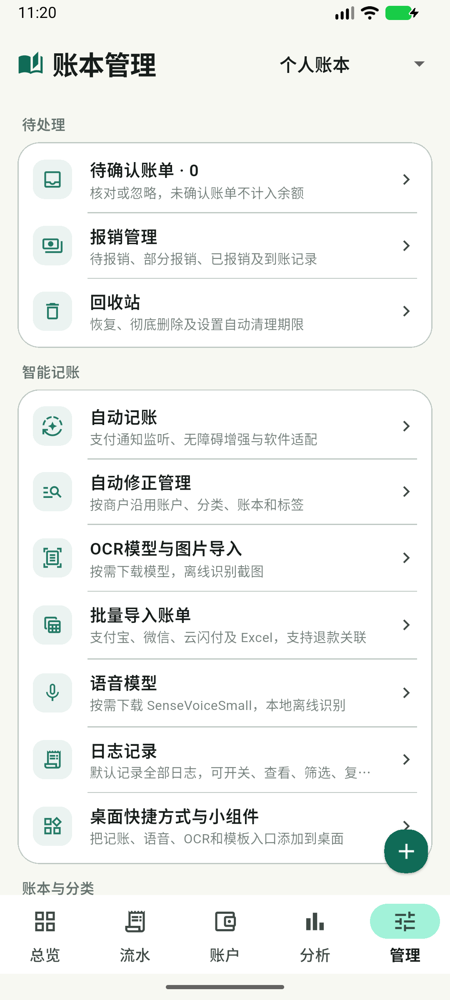

- 七个分组小标题：待处理、智能记账、账本与分类、资产与账单工具、周期计划、外观与个性化、数据与隐私。
- 每组一张白卡，行结构统一：浅绿圆角方块图标 + 16sp 标题 + 12sp 灰色副标题 + 右侧箭头，行间 1px 分割线。
- 共 26 行，长滚动。
- 「金额隐私模式」行右侧为深灰开关。
- FAB 悬浮在右下，滚动时会压住当前行尾部。

### 3.7 记一笔

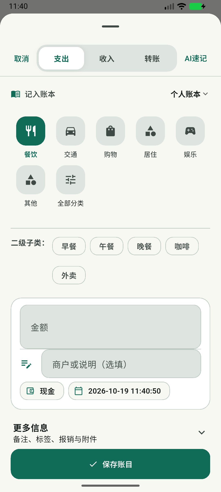

- 全屏底部弹窗，顶部大圆角 + 拖拽条。
- 顶栏：取消 ｜ 支出 / 收入 / 转账 分段控件（选中白底）｜ AI 速记。
- 「记入账本：个人账本 ▾」。
- 分类网格 5 列 × 2 行：餐饮（深绿选中）、交通、购物、居住、娱乐、其他、全部分类；图标位于浅灰圆角方块内，标签在下。
- 「二级子类：」早餐 / 午餐 / 晚餐 / 咖啡 / 外卖 胶囊。
- 白色内嵌卡：大号金额框（灰绿填充）、商户或说明框（左侧图标悬空、输入框左缩进）、「现金」胶囊、「2026-10-19 11:40:50」日期胶囊。
- 「更多信息 ▾」：备注、标签、标记待报销、图片附件。
- 底部全宽深绿「✓ 保存账目」。

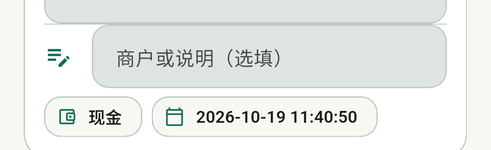

### 3.8 外观与主题

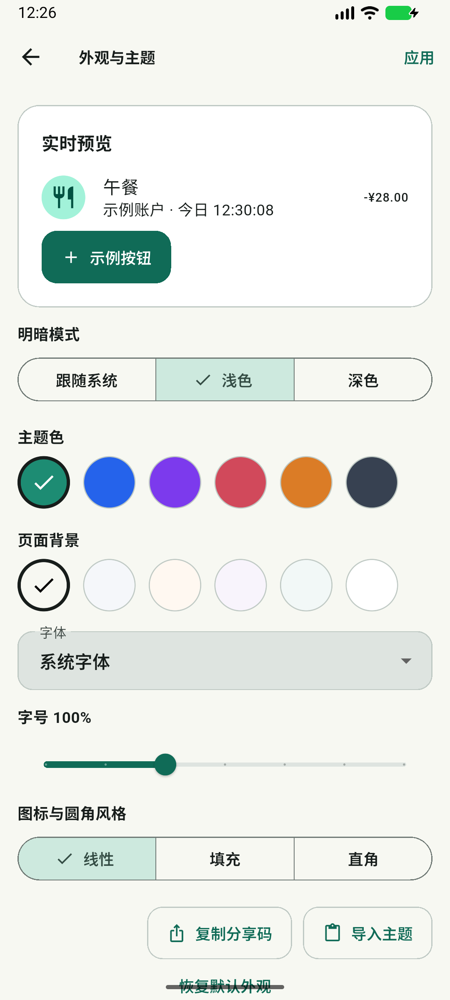

- 「实时预览」卡：午餐示例行 + 示例按钮。
- 明暗模式三段：跟随系统 / 浅色 / 深色。
- 主题色 6 个圆点（绿色选中）。
- 页面背景 6 个圆点。
- 字体下拉、字号滑杆 100%。
- 图标与圆角风格：线性 / 填充 / 直角。
- 复制分享码 / 导入主题。
- 底部「恢复默认外观」。

### 3.9 空态、删除、回收站、弹窗

| 状态 | 现状 |
|---|---|
| 空态 | 卡片内居中：绿色书本图标、16sp 粗标题、14sp 灰色说明；无操作按钮 |
| 左滑删除 | 行尾露出红色删除块；删除后底部弹出「账目已移入回收站」+ 绿色「撤销」，5 秒 |
| 回收站 | 顶部「自动彻底删除」设置卡（永不自动删除 ▾），下方流水卡，恢复/删除为两个纯图标 |
| 清空确认 | 圆角 28 浅灰弹窗，「清空回收站?」+ 说明 + 取消 + 绿色「全部删除」 |

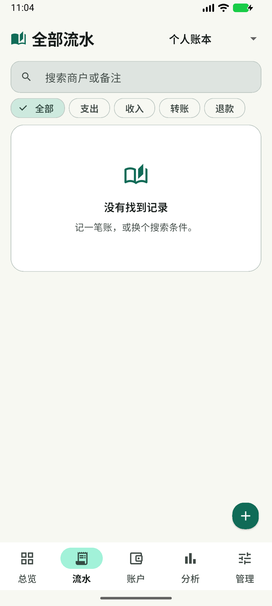

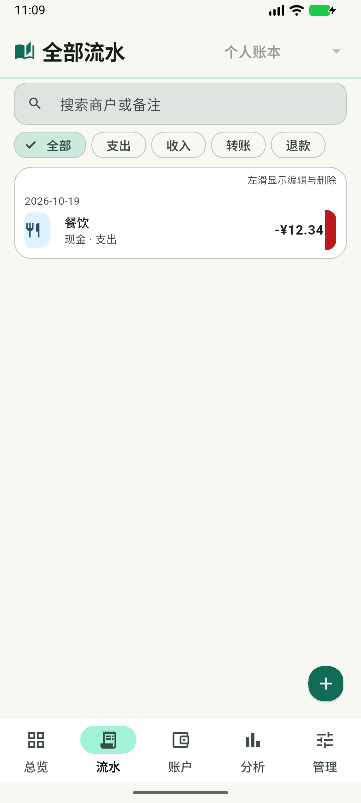

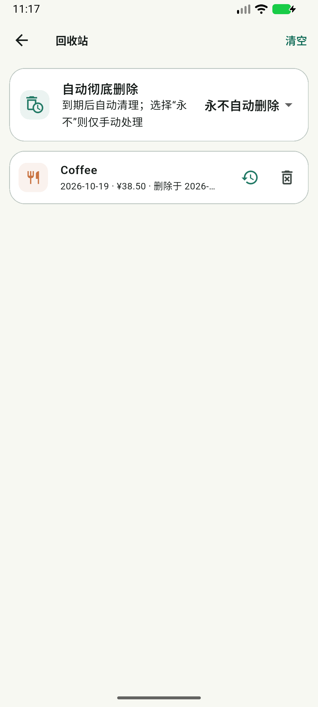

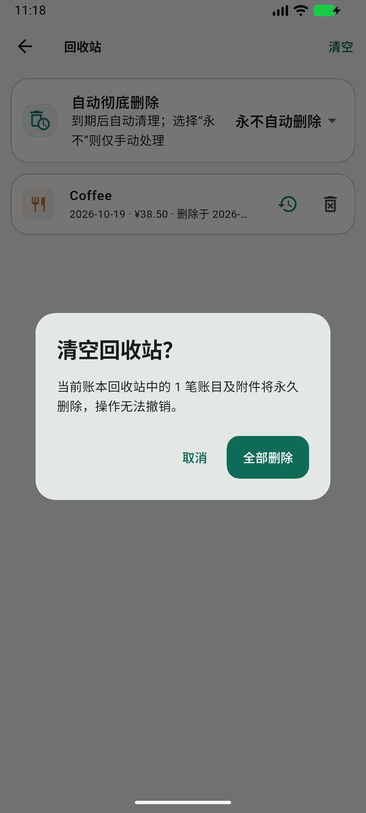

### 3.10 深色模式

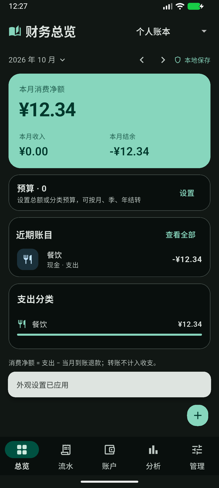

- 页面底色 `#111714`，卡片 `#090F0D`（比背景更暗），1px 深灰描边。
- 主色变为薄荷绿 `#87D6BD`，选中胶囊 `#005141`。
- 文字为白色系，辅助文字灰绿。
- 深色下卡片"下沉"，层次主要依靠描边而不是亮度。

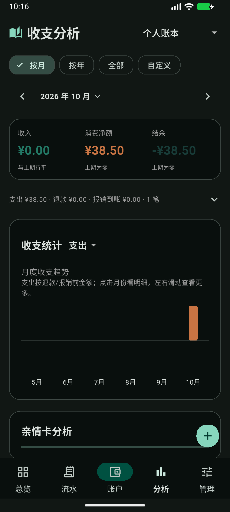

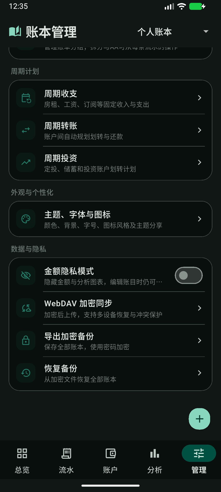

### 3.11 大字号与窄屏

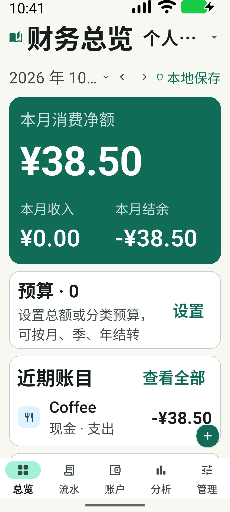

- 标题「财务总览」与账本名互相挤压，账本名变为「个人…」。
- 月份「2026 年 10…」被截断。
- 卡片整体变高，说明文字换行增多。

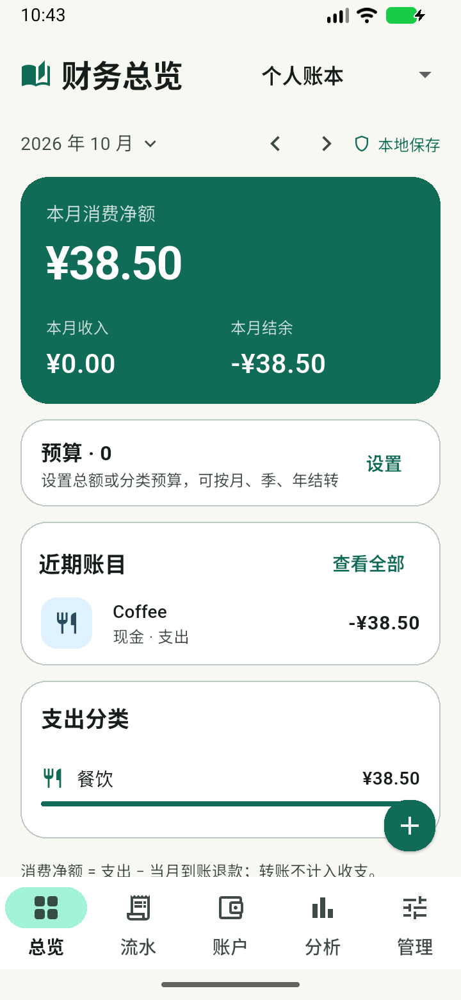

- 窄屏下仍为单列布局，底部导航与 FAB 保留。
- 顶部标题、月份、账本名空间紧张；FAB 会覆盖内容。

---

## 4. 七维评分

| 维度 | 得分 | 判断依据 |
|---|---:|---|
| 视觉美观度 | **7.0** | 品牌绿 + 卡片体系完整、留白舒适；扣分在图标同质、编辑器输入区错位、色彩语义混乱 |
| 操作便捷性 | **7.0** | 手动记账 4–5 次点击，删除有 5 秒撤销；FAB 需二次点击才能进最常用入口 |
| 导航合理性 | **5.5** | 五 Tab 清晰，但「管理」26 项成为杂物间；「分析」与「账户」部分职能重叠 |
| 易学易用性 | **6.0** | 中文文案清楚、默认值合理；左滑是隐藏手势、无首次引导、术语偏多 |
| 交互反馈 | **7.0** | 加载/撤销/错误齐全；但成功与失败同色、无触觉反馈、动画极少 |
| 视觉一致性 | **6.0** | 卡片/圆角统一，但硬编码颜色与字号导致跨页漂移 |
| Android/iOS 适配 | **5.0** | 纯 Material，无 Cupertino/平台自适应；大字号与窄屏出现截断；触控目标偏小 |

**平均分：6.2 / 10**

---

## 5. 关键实测数据

| 指标 | 实测值 | 评价 |
|---|---:|---|
| 底部导航高度 | 72dp | 合格 |
| 筛选 Chip 高度 | ≈30dp | ❌ 小于 48dp 最小触控目标 |
| 主 FAB 尺寸 | 48dp | 合格（M3 建议 56dp） |
| 页面左右边距 | 16dp | 合格 |
| 卡片内边距 | 22dp | 偏大，信息密度偏低 |
| 浅色 surface / 卡片 | `#F7F8F2` / `#FFFFFF` | 对比良好 |
| 深色 surface / 卡片 | `#111714` / `#090F0D` | ⚠ 卡片比背景更暗，层级倒置 |
| 主色 | 浅 `#106B57` / 深 `#87D6BD` | 对比 6.4:1 / 10.8:1，合格 |
| 次要文字 | `#3F4945` on `#F7F8F2` | 8.7:1，合格 |
| 硬编码颜色 | 159 处 | ⚠ 主题漂移风险 |
| 硬编码字号 | 108 处（10–36） | ⚠ 排版不统一 |
| `Semantics` / `Tooltip` | 2 / 1 处 | ❌ 无障碍覆盖极低 |
| `HapticFeedback` | 0 处 | ❌ 无触觉反馈 |
| `Cupertino` / `Platform.isIOS` | 0 处 | ❌ 无 iOS 适配 |
| 加载指示器 | 48 处 | ✅ 覆盖充分 |
| 错误处理 | 93 处 | ✅ 已中心化 |

---

## 6. 问题清单

### 6.1 P0 — 影响可用性 / 无障碍

| # | 位置 | 现象与原因 | 用户影响 | 建议 |
|---|---|---|---|---|
| P0-1 | `home_shell.dart:1281-1301` | 筛选 `ChoiceChip` 同时使用 `VisualDensity.compact` + `MaterialTapTargetSize.shrinkWrap`，实测高约 30dp | 手指稍偏即点不中；运动障碍用户几乎不可用 | 去掉 `shrinkWrap`，高度 ≥48dp；或改为分段控件 |
| P0-2 | 全局大字号 | 约 1.5× 字号时：标题与账本名挤压、账本名变「个人…」、月份「2026 年 10…」截断、管理页副标题出现省略号 | 老年/低视力用户读不全关键信息 | AppBar 标题限制行数 + 账本名改图标按钮；月份用 `FittedBox` 或短格式；副标题最多 2 行 |
| P0-3 | `action_form.dart:4-9` | `showError` 使用与成功提示完全相同的 SnackBar，无图标、无 error 色、无重试 | 无法一眼区分"保存成功"与"操作失败" | 失败 SnackBar 使用 `errorContainer` + 错误图标 + 可选「重试」 |
| P0-4 | `15-destructive-dialog.png` | 「全部删除」使用主色绿 | 与"确认/继续"语义冲突，误触成本高 | 破坏性按钮统一 `colorScheme.error` |
| P0-5 | 管理页 / 长列表 | 悬浮 FAB 压住当前行尾部（`05-manage-light.png`） | 行尾箭头与点击区被遮挡 | 列表底部预留 88–96dp；滚动时缩小或隐藏 FAB |

### 6.2 P1 — 体验与一致性

| # | 位置 | 现象与原因 | 建议 |
|---|---|---|---|
| P1-1 | 全局 | 159 处 `Colors.*` + 108 处 `fontSize`，换主题/深色靠人肉维护 | 建立 `AppColors / AppType / AppSpace` token，页面只引用语义 token |
| P1-2 | 账户 / 分析 / 首页 | 负数与支出颜色不统一：首页结余白、账户页橙、分析页深色、净资产红 | 定义语义色并全站唯一：支出=橙、收入=绿、负结余=error、转账=蓝灰 |
| P1-3 | 管理页 | 26 项 / 7 组，预算、分类、标签等高频设置位于中段 | 重组为 4 组 + 顶部 2×2 高频宫格；低频项折叠进「高级」 |
| P1-4 | `12-fab-menu.png` | 手动记账需「FAB → 手动记账」两次点击 | 单击直接进手动记账；长按/上滑展开其它入口 |
| P1-5 | `11-editor-inputs.png` | 金额框与商户框垂直间距仅约 3dp；商户框左侧缩进约 40dp，图标悬空 | 统一左对齐、间距 12dp，图标改为 `prefixIcon` |
| P1-6 | `03-accounts-light.png` | 现金/银行卡/微信/支付宝全部使用同一个钱包图标 | 按账户类型区分图标与色相 |
| P1-7 | `04-analysis-light.png` | 单笔数据渲染成一根孤柱，柱区上下大量空白；说明文字占两行 | 图表固定高 180dp；单点时改展示分类占比/环比；说明收进 ⓘ |
| P1-8 | 深色模式 | `surfaceContainerLowest #090F0D` 比 `surface #111714` 更暗，卡片"下沉" | 深色卡片改用更亮的 `surfaceContainerLow` 系，保留描边 |
| P1-9 | 全局无障碍 | `Semantics` 仅 2 处、`Tooltip` 1 处；纯图标按钮无标签 | 图标按钮补 `tooltip` + `semanticLabel`；金额提供完整读法 |
| P1-10 | 流水页 | 无当前筛选合计、无批量操作、日期头不吸顶 | 筛选下方加收入/支出/净额汇总条；长按多选；日期头吸顶 |
| P1-11 | `16-trash.png` | 删除时间被截断为「删除于 2026-…」 | 允许两行或改相对时间「3 天前」 |
| P1-12 | 总览 | 0 预算仍占整张卡片 | 无预算时收为一行 CTA「设置本月预算」 |

### 6.3 P2 — 打磨

| # | 位置 | 现象 | 建议 |
|---|---|---|---|
| P2-1 | 全局 | 0 处 `HapticFeedback` | 选择/保存轻震、删除中震 |
| P2-2 | iOS | 无 Cupertino、无自适应日期/弹窗 | 使用 `.adaptive` 组件与 `TargetPlatform` 分支 |
| P2-3 | `13-empty-state.png` | 只有图标 + 文案，无操作按钮 | 增加「记一笔」主按钮 |
| P2-4 | 流水页 | 常驻「左滑显示编辑与删除」 | 改为首次一次性 coach mark |
| P2-5 | 记一笔 | 日期显示到秒「2026-10-19 11:40:50」 | 默认只显示日期，时间放进更多信息 |
| P2-6 | 全局 | 动画仅 3 处 `AnimatedContainer`，页面切换生硬 | 统一 150–250ms 过渡，尊重"减少动态效果" |
| P2-7 | 管理页 | 金额隐私开关关闭态发灰，像禁用 | 提高关闭态对比，或改 `SwitchListTile` |
| P2-8 | 流水页 | 搜索框填充 `#DEE4E0` 偏重 | 降到 `surfaceContainerLow`，聚焦时再加深 |

### 6.4 值得保留

- 品牌绿体系与"描边代替阴影"的卡片语言
- 删除即入回收站 + 5 秒撤销
- 底部弹窗 `useSafeArea`
- 加载态覆盖面广
- 金额隐私模式
- 主题分享码

---

## 7. 主要页面改版方案

### 7.1 总览

**目标**：3 秒内看清"本月花了多少、还剩多少、哪里花超了"。

```
[财务总览]                         [账本 ▾]
[‹] 2026 年 10 月 [›]      [本月]      🔒 本地
┌────────────────────────────────────────┐
│ 本月净支出                              │
│ ¥38.50                    ↑12% 环比     │
│ 收入 ¥0.00        结余 -¥38.50（红）    │
└────────────────────────────────────────┘
[待确认 3 笔 · 去处理]                    ← 待处理前置
预算   已用 0 / 未设置           [设置]   ← 一行式
近期账目                          查看全部
  · 今天   Coffee          -¥38.50
支出分类（本月）
  餐饮  █████████████  100%  ¥38.50
```

- 主金额 34/40sp，副指标 16sp；负结余使用 `error`
- 月份支持左右滑动
- 点击分类跳转分析页并带上筛选
- 底部预留 96dp 避开 FAB

### 7.2 流水

- 搜索 + 筛选吸顶，Chip 高度 48dp
- 新增汇总条：`收入 ¥x · 支出 ¥y · 净额 ¥z · n 笔`
- 按日分组，日期头吸顶并显示当日小计
- 行高 64dp；左滑动作宽 72dp，删除红色；保留 5 秒撤销
- 长按进入多选：批量删除 / 改分类 / 加标签
- 首次一次性提示替代常驻"左滑"文案
- 空态增加「记一笔」按钮

### 7.3 账户

- 净资产卡：主数字 + 总资产/总负债两列；眼睛按钮 48dp
- 报销/债务/理财三卡合并为一行三段式摘要
- 账户行 64dp，按类型区分图标与色相
- 「归档」收进右上角溢出菜单；「+」增加文字标签
- 分组头吸顶

### 7.4 分析

- 周期 Chip 统一 48dp；去掉「2026 年 10 月」旁多余的 ▾
- 汇总卡固定三列：收入（绿）/ 支出（橙）/ 结余（负红、正中性）
- 图表固定 180dp；无数据月份画 0 基线
- 单笔时切换为「分类占比 + 环比」
- 说明文字改为标题旁 ⓘ
- 增加分类排行列表：图标 + 名称 + 百分比 + 进度条
- 无数据时展示空态与「记一笔」

### 7.5 管理（重点）

```
[高频 2×2 宫格]  预算 · 分类 · 标签 · 模板
[记账与自动化]   自动记账 / 自动修正 / OCR / 语音 / 批量导入 / 日志
[数据与资产]     资产与负债 / 币种 / 分组 AA / 周期计划
[备份与隐私]     WebDAV / 导出 / 恢复 / 金额隐私
[外观与关于]     主题字体图标 / 桌面快捷方式 / 关于
```

- 顶部增加设置搜索
- 低频项默认折叠
- 底部留白 96dp
- 副标题最多 2 行，禁止句中省略

### 7.6 记一笔（核心路径）

- FAB 单击直达编辑器；长按展开语音/一句话/OCR/模板
- 打开即聚焦金额，数字键盘带「完成」
- 金额框 64dp；分类改 4 列（411dp 下 5 列每格仅约 72dp）
- 金额与商户框左对齐、间距 12dp，图标作为 `prefixIcon`
- 日期默认只显示日期
- 底部「保存账目」常驻键盘上方；增加「保存并再记一笔」
- 顶部展示最近 2 个模板入口
- 目标：常用支出 **3 次点击 + 输入金额** 完成

### 7.7 次级页

- 回收站：完整删除时间或相对时间；图标按钮加 tooltip；清空用 error 色
- 弹窗：圆角 28、标题 20sp、正文 ≤2 行、动作右对齐、破坏性红色
- 空状态：图标 + 标题 + 一句说明 + 主按钮

---

## 8. 设计系统 v1

### 8.1 颜色

保留品牌种子 `#1D8C73`，只做语义化收敛。

| Token | 浅色 | 深色 | 用途 |
|---|---|---|---|
| `surface` | `#F7F8F2` | `#111714` | 页面背景 |
| `surfaceCard` | `#FFFFFF` | `#171D1B` | 卡片（深色改为更亮） |
| `surfaceSunken` | `#EFF5F1` | `#0C1210` | 搜索/输入底 |
| `primary` | `#106B57` | `#87D6BD` | 主按钮、选中 |
| `onPrimary` | `#FFFFFF` | `#002019` | 主色上的文字 |
| `primaryContainer` | `#A2F2D9` | `#005141` | 选中胶囊 |
| `onSurface` | `scheme.onSurface` | — | 主文字 |
| `onSurfaceVariant` | `#3F4945` | `#BFC9C3` | 次要文字 |
| `outlineVariant` | `#BFC9C3` | `#3F4945` | 1px 描边 |
| `error` | `#BA1A1A` | `#FFB4AB` | 错误、负结余、破坏性 |
| `income` | `#237A66` | `#7FD8C0` | 收入 |
| `expense` | `#C97443` | `#F0A57A` | 支出 |
| `transfer` | `#5C6B76` | `#A9BAC6` | 转账 |
| `refund` | `#6B5B95` | `#C3B2F0` | 退款 |

规则：

- 颜色只表达语义，不按页面各自定义
- 深色不使用纯黑
- 深色卡片必须比页面背景亮

### 8.2 字体

| Role | Size / Line | Weight | 用途 |
|---|---|---|---|
| `amountXL` | 34 / 40 | 700 | 首页主金额 |
| `h1` | 24 / 30 | 700 | 页面标题 |
| `h2` | 20 / 26 | 700 | 卡片标题 |
| `h3` | 16 / 22 | 600 | 列表主标题 |
| `body` | 14 / 20 | 400 | 正文 |
| `label` | 13 / 18 | 600 | Chip / 按钮 |
| `caption` | 12 / 16 | 400 | 辅助信息 |
| `micro` | 11 / 14 | 500 | 仅时间戳，禁止用于正文 |

替换现状 10–36 的 108 处散值；中文行高不低于 1.4。

### 8.3 间距 / 圆角 / 阴影

- 间距：`4 / 8 / 12 / 16 / 20 / 24 / 32`
- 页面 16；区块间 24；卡片内 16–20；列表行垂直 12
- 圆角：`8 / 12 / 16 / 20 / 28`
- 卡片 20；输入 16；弹窗 28；底部弹窗顶部 28；Chip 全圆
- 阴影：卡片 0（1px 描边）；FAB 2；菜单 2；弹窗 3

### 8.4 图标

- 24dp 默认、20dp 行内、16dp 角标
- 线性/填充由现有 `iconStyle` 统一控制
- 账户、分类、功能入口建立固定映射表，禁止同一图标复用于不同语义

### 8.5 组件

| 组件 | 规范 |
|---|---|
| 主按钮 | 高 48，填充 primary，圆角 16，全宽用于保存 |
| 次按钮 | 描边或 tonal，高 48 |
| 危险按钮 | error 背景/文字，必须二次确认 |
| 图标按钮 | 48×48，必须有 tooltip |
| 卡片 | 1px `outlineVariant`，无阴影，padding 16–20 |
| 输入框 | 高 56，filled `surfaceSunken`，水平 16，错误文案在下方 |
| 弹窗 | 圆角 28，padding 24，标题 20，动作右对齐 |
| 底部弹窗 | 顶部圆角 28，拖拽条 32×4，最大高 90%，底部 CTA 常驻 |

### 8.6 动效与触觉

- 150ms 微交互、200ms 常规、250ms 弹窗
- 页面使用 SharedAxis / FadeThrough
- 选择轻震、保存轻震、删除中震、失败重震
- 尊重系统「减少动态效果」

### 8.7 无障碍与适配

- 触控目标 ≥48×48（含 Chip、图标按钮）
- 正文对比 ≥4.5:1，大字 ≥3:1
- 字号放大到 2.0× 不截断、不重叠（当前 1.5× 已出问题）
- 断点：
  - `<600` 底部导航
  - `600–840` NavigationRail
  - `>840` Rail + 最大内容宽 720
- 现有 `navigationRailTheme` 已是良好基础，补齐双栏即可

---

## 9. 实施计划与验收

| 阶段 | 内容 | 预估 |
|---|---|---|
| **S0** | 修复现有 3 个失败测试，建立干净基线 | 0.5 天 |
| **S1（P0）** | 触控目标、极端字号/窄屏、失败反馈、危险色、FAB 留白 | 2–3 天 |
| **S2（P1）** | token 迁移、颜色语义、管理页 IA、编辑器对齐、账户图标、分析图表、Semantics | 4–6 天 |
| **S3（P2）** | 震动、动效、空态 CTA、iOS 自适应、细节打磨 | 2–3 天 |

**每阶段验收**

- `flutter analyze` → 0 issue
- `flutter test --concurrency=1` → 不低于当前 253 通过（当前 253 通过 / 3 失败）
- 手工回归：记一笔、编辑、删除 + 撤销、筛选、深/浅色、1.5× 字号、320dp 窄屏、TalkBack 基本朗读
- 不改变业务逻辑、数据模型与 Riverpod 状态结构

**已知失败测试（改版前先处理）**

- `maintenance_widget_test.dart`
- `pending_batch_test.dart`
- `wechat_receipt_test.dart`（加载中断，疑似环境问题）

---

## 10. 待确认决策

1. **FAB 行为**：单击直达手动记账（推荐）还是保留二次菜单？
2. **管理页重构**：允许改成「高频宫格 + 4 组」吗？（会改变入口位置）
3. **品牌色**：继续沿用 `#1D8C73` 绿色体系？（推荐保留）
4. **范围**：先做 S1 + S2，S3 另排期？还是三阶段一次做完？

确认后进入代码实施。
